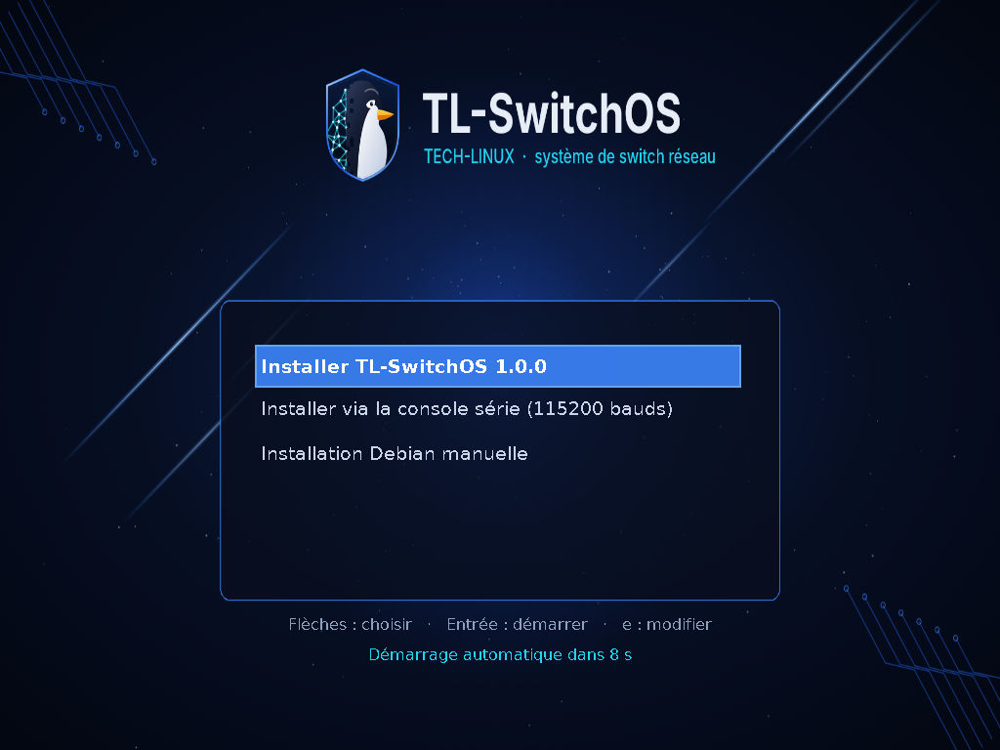
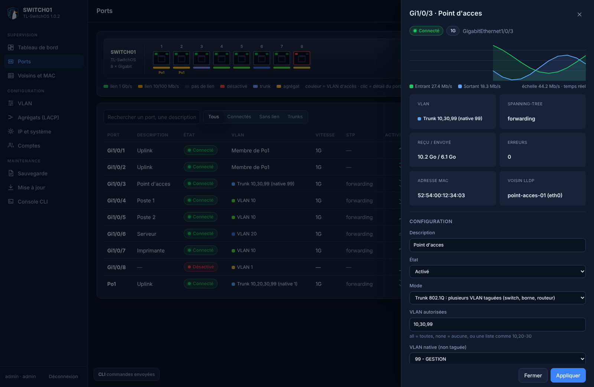
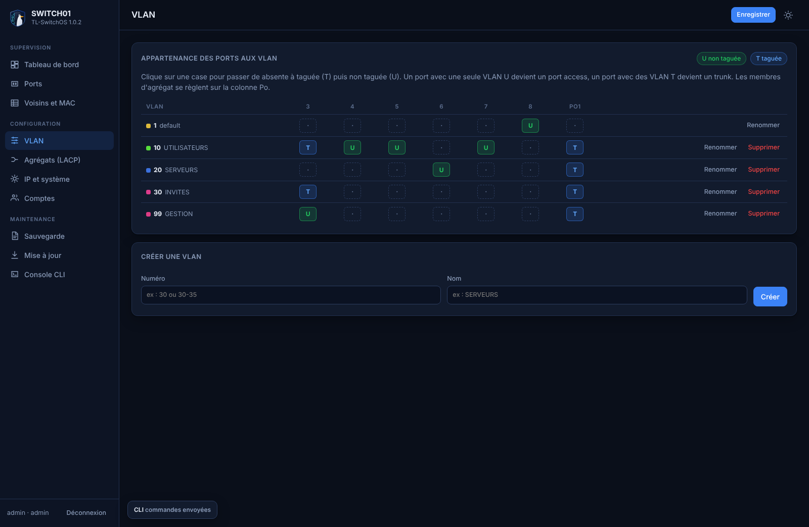

# TL-SwitchOS

**Un PC x86_64 à plusieurs ports Ethernet devient un switch administrable de niveau 2.**

TL-SwitchOS s'installe depuis une clé USB, comme un système de switch : une ISO, deux questions, et le switch démarre avec son adresse affichée à l'écran. On l'administre ensuite en CLI (console série ou SSH) ou depuis une interface web HTTPS.



## Fonctions

- **CLI familière aux administrateurs réseau** : `conf t`, `interface Gi1/0/3`, `switchport access vlan 20`, `show vlan brief`, `wr`… avec abréviations, `?` et Tab.
- **Interface web HTTPS** : façade des ports en direct, ports, VLAN, agrégats, IP, comptes, table MAC, voisins LLDP, sauvegarde de la config et console web. Chaque action affiche les commandes CLI équivalentes.
- **VLAN 802.1Q** (access, trunk, VLAN native), **LACP** (Port-channel), **RSTP/STP**, PortFast, BPDU Guard, **LLDP**, NTP, MTU jumbo, interfaces `Vlan` de gestion en IP fixe ou DHCP.
- **Sécurité des ports** : port security (MAC autorisées, maximum, violation protect/restrict/shutdown, err-disable), **DHCP snooping**, **storm control** broadcast/multicast.
- **Multicast** : IGMP snooping (actif par défaut) et querier. **Port mirroring (SPAN)** vers une sonde ou un poste Wireshark.
- **Supervision** : **SNMP v2c et v3** (SHA-2, AES), **syslog distant** (UDP/TCP), **export Prometheus** (trafic, erreurs, STP, sécurité par port), utilisable aussi par Zabbix.
- **Administration** : connexion SSH et web par **RADIUS** (par exemple le NPS d'un annuaire Active Directory), comptes locaux en secours. **Sauvegarde automatique** de la config en SCP vers un NAS, avec historique.
- **Mises à jour signées** par dépôt APT ou fichier `.tlsu`, avec retour automatique à la version précédente en cas d'échec.
- **Retour arrière automatique** si une modification coupe l'accès de gestion.
- Niveau 2 uniquement : le routage et le filtrage restent sur le routeur ou le pare-feu. Le pont ne filtre que ce que demandent port security, DHCP snooping et storm control.

| Ports | VLAN |
|---|---|
|  |  |

## Matériel

- PC x86_64 (BIOS ou UEFI) avec au moins 2 ports Ethernet. Testé avec 2 Go de RAM et 10 Go de disque.
- Testé : machine virtuelle avec cartes Intel e1000e (VMware Workstation, QEMU/KVM). Cible : boîtier Atom D510 à 6 ports Intel.
- Sous un hyperviseur, mettre une carte réseau virtuelle par port du switch.

## Installation

### 1. Télécharger l'ISO

Dans **[Releases](../../releases/latest)**, télécharge `TL-SwitchOS-<version>-amd64.iso` et son fichier `.sha256`, puis vérifie l'image :

```bash
sha256sum -c TL-SwitchOS-1.0.2-amd64.iso.sha256
```

La ligne doit se terminer par `OK`. Sous Windows : `Get-FileHash TL-SwitchOS-1.0.2-amd64.iso` dans PowerShell, puis compare avec le contenu du `.sha256`.

### 2. Installer

1. Grave l'ISO sur une clé USB (Rufus en mode **DD**, balenaEtcher ou `dd`).
2. Branche **un** port du switch sur un réseau qui a accès à Internet : les paquets Debian sont téléchargés pendant l'installation.
3. Démarre sur la clé. Le menu TL-SwitchOS propose l'installation standard, l'installation par la console série (115200 bauds) ou une installation Debian manuelle.
4. L'installateur, en français et en clavier AZERTY, pose deux questions : **nom du switch** et **VLAN de gestion**.
5. Vient ensuite l'étape réseau de Debian : DHCP automatique, ou IP fixe si tu la saisis. Le switch garde cette adresse sur son interface `Vlan` de gestion.
6. L'installateur demande **quel disque** utiliser et comment le partitionner (guidé ou manuel). Rien n'est effacé sans confirmation.
7. TL-SwitchOS s'installe d'une traite, puis la machine redémarre.

L'écran de connexion affiche l'adresse du switch (mise à jour en direct si elle change) et les identifiants provisoires :

```
TL-SwitchOS 1.0.2 - switch01 - console tty1

  Vlan1     web : https://192.168.1.30   ssh : ssh admin@192.168.1.30

  Identifiant provisoire :  admin
  Mot de passe provisoire : admin
```

Le journal complet de l'installation est dans `/var/log/tlswitch-install.log`. Si l'étape TL-SwitchOS échoue (coupure Internet par exemple), l'assistant reprend au premier démarrage.

### Autres méthodes

- **Par le réseau (iPXE)** : `bash construire-iso.sh --ipxe http://192.168.1.5/tlswitch` produit un dossier à copier sur un serveur HTTP, plus l'entrée à ajouter au menu iPXE.
- **Sur une Debian 13 déjà installée** :
  ```bash
  cd tl-switchos/tlswitch
  TLS_HOSTNAME=switch01 TLS_MGMT_VLAN=99 TLS_IP=192.168.1.30/24 TLS_GW=192.168.1.1 bash installer-tlswitch.sh
  reboot
  ```
  Sans `TLS_IP`, l'installateur reprend l'IP actuelle de la machine.

Au premier démarrage, les ports sont renommés `Gi1/0/1` à `Gi1/0/N` dans l'ordre PCI, tous en access sur la VLAN de gestion.

## Accès

| Accès | Comment |
|---|---|
| Console | écran local ou série `ttyS0` **115200 8N1** : login `admin`, CLI directe |
| SSH | `ssh admin@<ip>` : CLI directe |
| Web | `https://<ip>` (certificat auto-signé) |
| Secours | `start-shell` depuis la CLI niveau 15 (root est verrouillé et interdit en SSH) |

**Première connexion : `admin` / `admin`.** Le switch exige un nouveau mot de passe (8 caractères minimum) avant de donner la main. Il est enregistré aussitôt et devient aussi l'enable secret.

Comptes : `username <nom> privilege 15 secret 0 <motdepasse>` (administrateur) ou `privilege 1` (lecture seule, `enable` pour monter). Les mêmes comptes servent en console, en SSH et sur le web.

> Bonne pratique : n'ouvrir l'accès de gestion (SSH, web) qu'à un bastion d'administration.

## Exemple de configuration

```
conf t
hostname switch01
vlan 20
 name SERVEURS
vlan 30
 name INVITES
vlan 99
 name GESTION
!
interface Gi1/0/1
 description Uplink
 switchport mode trunk
 switchport trunk allowed vlan 20,30,99
!
interface Gi1/0/2
 description Point d'acces
 switchport mode trunk
 switchport trunk allowed vlan 30,99
 switchport trunk native vlan 99
 spanning-tree portfast
!
interface range Gi1/0/3-6
 description Postes invites
 switchport mode access
 switchport access vlan 30
 spanning-tree portfast
 spanning-tree bpduguard enable
!
interface Vlan99
 ip address 192.168.1.30 255.255.255.0
ip default-gateway 192.168.1.1
end
wr
```

Côté équipement en amont, le port qui descend vers ce switch doit être en trunk avec les mêmes VLAN taguées.

## Sécurité, supervision et sauvegarde (1.0.3)

```
! supervision
snmp-server user supervision auth sha256 <cle-auth> priv aes <cle-priv>
snmp-server location Salle serveur
logging host 192.0.2.30
logging host 192.0.2.31 transport tcp port 6514
prometheus exporter
prometheus exporter allow 192.0.2.0/24
!
! administrateurs de l'annuaire (serveur NPS ou FreeRADIUS)
radius-server host 192.0.2.10 key <cle-partagee>
aaa authentication login default group radius local
username jdupont privilege 15 radius
!
! sauvegarde vers un NAS, a chaque wr et chaque jour si la config a change
archive path scp://sauvegarde@192.0.2.20/volume1/switchs
archive write-memory
archive time-period 1440
!
ip dhcp snooping
ip dhcp snooping vlan 10,30
monitor session 1 source interface Gi1/0/3 both
monitor session 1 destination interface Gi1/0/8
!
interface Gi1/0/1
 ip dhcp snooping trust
interface range Gi1/0/4-6
 switchport port-security
 switchport port-security maximum 2
 switchport port-security violation restrict
 storm-control broadcast level pps 500
```

- **RADIUS** : le compte (`username … radius`) doit exister sur le switch, son mot de passe est vérifié par le serveur RADIUS. Un compte local niveau 15 avec mot de passe reste obligatoire pour le secours. Côté NPS, déclarer le switch comme client RADIUS (même clé) et une stratégie pour le groupe AD des administrateurs réseau. Test : `test aaa group radius <compte> <mot de passe>`.
- **Sauvegarde** : `show archive` affiche la clé publique du switch, à ajouter dans `~/.ssh/authorized_keys` du compte sur le NAS. Chaque copie est horodatée (`SWITCH01-AAAAMMJJ-HHMMSS.conf`), l'historique est gardé sur le NAS et sur le switch (`archive maximum`, 10 par défaut). `archive config` sauvegarde tout de suite.
- **Port security** : une MAC en trop est jetée tout de suite. Avec `violation shutdown` (par défaut), le port passe `err-disabled` dans la minute. `clear errdisable interface Gi1/0/4` le réactive, `errdisable recovery interval 300` le fait tout seul.
- **Prometheus** : `http://<ip>:9101/metrics`. Zabbix le lit avec un élément HTTP et le prétraitement Prometheus, ou en SNMPv3.
- **DHCP snooping** : les réponses de serveur DHCP (v4 et v6) qui arrivent sur un port non `trust` sont jetées. Le lien montant vers le serveur DHCP doit être `trust`.

## Commandes utiles

```
show running-config | show startup-config | show running-config interface Gi1/0/2
show interfaces status | show interfaces trunk | show interfaces counters
show vlan brief | show mac address-table [vlan 20 | interface Gi1/0/3 | count]
show etherchannel summary | show spanning-tree | show lldp neighbors
show ip interface brief | show ip route | show version | show logging
configure terminal | configure confirm | configure terminal revert timer 10
write memory | copy running-config startup-config | write erase | reload
show install summary | show install updates | install update | install rollback
install add file <url ou usbflash0:fichier.tlsu> activate
ping <ip> | traceroute <ip> | clear mac address-table dynamic | enable | disable
show port-security | show ip dhcp snooping | show storm-control | show errdisable recovery
show ip igmp snooping [groups] | show monitor | show snmp | show logging hosts | show aaa servers
show archive | archive config | show metrics | test aaa group radius <compte> <mot de passe>
clear errdisable interface Gi1/0/4 | clear port-security dynamic
```

## Mises à jour

Une nouvelle version s'installe sur un switch en place, **sans réinstaller ni perdre la configuration**.

### Par le dépôt APT (recommandé)

TL-SwitchOS a son propre **dépôt APT signé**. Une seule commande met à jour TL-SwitchOS et Debian (correctifs de sécurité compris) :

- **CLI** : `show install updates` liste ce qui est disponible, puis `install update` installe et propose de redémarrer.
- **Web** : menu **Mise à jour** → **Rechercher les mises à jour** → **Installer les mises à jour**. L'avancement s'affiche en direct.

Le paquet `tlswitch` du dépôt ne remplace pas les fichiers à l'aveugle : il passe par le moteur de mise à jour du switch, qui vérifie, teste, sauvegarde et revient tout seul à l'ancienne version si la nouvelle ne fonctionne pas.

### Par fichier `.tlsu` (sans Internet, ou mise à jour majeure)

- **Web** : menu **Mise à jour**, choisis le fichier de la Release, **Vérifier le paquet** (version, signature, nouveautés), puis **Installer et redémarrer**.
- **CLI** : `install add file usbflash0:TL-SwitchOS-1.0.2.tlsu activate` (clé USB) ou `install add file http://…/TL-SwitchOS-1.0.2.tlsu activate`.

### Sécurité

- Dépôt APT signé (GPG), paquets `.tlsu` signés (ed25519) : un switch n'accepte que les mises à jour signées par la clé de l'ISO qui l'a installé.
- Avant d'activer une version, le switch teste le nouveau code avec ta configuration. Il sauvegarde la version en place, et au redémarrage il revient tout seul à la précédente si la nouvelle ne démarre pas. `install rollback` y revient à la demande.
- Une montée de version de Debian (mise à jour majeure) ne peut pas être annulée automatiquement. La configuration est sauvegardée dans `/var/lib/tlswitch/` avant l'opération.

## Construire l'ISO et les mises à jour

Les ISO, les paquets et le site sont fabriqués par un **serveur de construction** (conteneur LXC relié au dépôt GitHub, commun à plusieurs projets), le seul à détenir les clés de signature. Quand `VERSION` change dans `tlswitch/tlswitch.py`, il construit et signe tout, publie la Release, puis met à jour le dépôt du projet qu'il sert en lecture seule (dépôt APT, ISO, archive signée du site) derrière le reverse proxy. Le serveur web récupère le site sur ce dépôt et n'en publie que les versions correctement signées. Tout est durci : pare-feu, SSH par clé depuis le bastion seulement, constructions sans droits et cloisonnées. Mise en place : [outils/lxc/README.md](outils/lxc/README.md).

Pour construire à la main, sur une machine Linux reliée à Internet, depuis le dossier du dépôt :

```bash
bash construire-iso.sh                              # ISO   -> TL-SwitchOS-<version>-amd64.iso
bash fabriquer-maj.sh "Notes..."                    # .tlsu -> TL-SwitchOS-<version>.tlsu
bash fabriquer-deb.sh TL-SwitchOS-<version>.tlsu    # .deb  -> tlswitch_<version>_all.deb
```

> ⚠️ **Les clés (`cles/maj-privee.pem` et `cles/gnupg/`) ne doivent jamais aller sur GitHub** (le `.gitignore` les exclut). Sans elles, plus de mise à jour possible pour les switchs déjà installés : garde-en une sauvegarde hors ligne.

## Fiabilité

- **Retour arrière automatique** : depuis le SSH ou le web, toute modification qui touche l'accès de gestion (IP, VLAN des ports de gestion, agrégats, SSH, web) est annulée au bout de 5 min (CLI) ou 90 s (web) sans confirmation (`configure confirm`).
- **Démarrage à l'épreuve des erreurs** : startup-config, sinon sa sauvegarde, sinon lecture tolérante, sinon configuration usine (Vlan1 en DHCP).
- **Écritures atomiques** : pas de configuration à moitié écrite en cas de coupure de courant.
- **Surveillance chaque minute** : reconstruit le pont s'il a disparu, relance SSH, web, LLDP et RSTP.
- Chien de garde matériel, redémarrage automatique après un plantage noyau, fail2ban sur SSH, essais limités sur le web.
- Le switch utilise l'adresse MAC de son premier port, comme un switch matériel : il fonctionne sous VMware et ESXi sans réglage particulier pour sa propre gestion.

## Performances

- Pas de `br_netfilter` ni d'iptables sur le pont, routage IP coupé.
- Pour chaque port : anneaux RX/TX au maximum, regroupement des interruptions, EEE et pause frames coupés, répartition du trafic sur les cœurs (RPS), irqbalance, processeur en mode performance.
- Débit réel à mesurer avec `iperf3` (installé).

## Contenu du dépôt

| Fichier | Rôle |
|---|---|
| `construire-iso.sh` | Fabrique l'ISO d'installation (ou le dossier iPXE) |
| `fabriquer-maj.sh` | Fabrique un paquet de mise à jour signé (`.tlsu`) |
| `fabriquer-deb.sh` | Emballe le `.tlsu` en paquet Debian pour le dépôt APT |
| `outils/lxc/` | Serveur de construction et dépôts (LXC commun), site sur le serveur web : installateurs et guide |
| `outils/site/` | Site vitrine généré à chaque version (présentation, téléchargements, versions) |
| `outils/publier-release.sh`, `outils/depot-apt.sh` | Recette TL-SwitchOS : ISO, paquets, dépôt APT, Release |
| `tlswitch/tlswitch.py` | Moteur et CLI (Python 3, bibliothèque standard uniquement) |
| `tlswitch/tlswitch_web.py`, `tlswitch/web/` | Interface web HTTPS |
| `tlswitch/installer-tlswitch.sh` | Installe TL-SwitchOS sur une Debian 13 |
| `tlswitch/maj.sh` | Intégration système rejouée à chaque installation et mise à jour |
| `tlswitch/os-upgrade.sh` | Montée de version de Debian |
| `tlswitch/di/` | Questions, disque et étape finale de l'installateur Debian |
| `tlswitch/boot/` | Thème du menu de démarrage |
| `tests/lab.sh` | Lab de test (namespaces Linux, routeur simulé en LACP) |
| `tests/maj-test.sh` | Tests des mises à jour (paquets piégés, retour automatique, rollback) |
| `tests/securite-test.sh` | Tests des fonctions de sécurité sur un vrai noyau (port security, DHCP snooping, storm control, SPAN) |

## Tests

- **Installation complète** depuis l'installateur Debian, en machine virtuelle : aucune question hors nom et VLAN, disque unique effacé automatiquement, IP DHCP reprise, premier démarrage avec IP affichée avant le login, connexion `admin`/`admin` avec changement forcé, CLI, web et SSH.
- **Lab réseau** sur un vrai noyau Linux : isolation des VLAN, access, trunk, VLAN native, LACP avec perte d'un lien, changement à chaud, retour arrière automatique, reconstruction après incident, idempotence.
- **Mises à jour** : paquets piégés refusés (manifeste modifié, contenu remplacé, autre clé), version cassée avec retour automatique, erreur de syntaxe détectée avant installation, `install rollback`.
- **Fonctions 1.0.3** sur un noyau Linux réel (pont + namespaces) : port security (MAC statique, apprentissage limité, rejet, err-disable), DHCP snooping, storm control, chargement des règles nftables. Client RADIUS testé contre un serveur de test (accepté, refusé, mauvaise clé). Export Prometheus, rendu et relecture de toute la configuration.
- Pas encore testé : RSTP avec `mstpd` sur Debian 13, le débit réel sur Atom D510, une vraie montée Debian 13 → 14, et en 1.0.3 le SPAN (le noyau de test n'a pas `tc matchall`), SNMPv3 avec `snmpd`, le RADIUS en SSH via `pam_radius_auth` et un vrai NPS.

Historique des versions : [CHANGELOG.md](CHANGELOG.md).

## Licence

GPL-3.0 (fichier `LICENSE`). TL-SwitchOS reprend une syntaxe de commandes courante chez les équipementiers réseau, sans affiliation avec aucun d'eux. Debian et Linux sont sous licence GPL : en cas de diffusion, fournir les sources.
